# Dev Toolbox user walkthrough

A practical tour of the installed desktop app, version **0.3.2**, captured on 1 November 2026.

## Contents

- [Your workspace](#your-workspace)
- [Turn a task into Git-ready text](#turn-a-task-into-git-ready-text)
- [Capture task details from a screenshot](#capture-task-details-from-a-screenshot)
- [Find and reuse saved tasks](#find-and-reuse-saved-tasks)
- [Format XML, XAML, and JSON](#format-xml-xaml-and-json)
- [Compare two versions of text](#compare-two-versions-of-text)
- [Generate a barcode or QR code](#generate-a-barcode-or-qr-code)
- [Generate many codes together](#generate-many-codes-together)
- [Reuse code generations](#reuse-code-generations)
- [Write structured test cases](#write-structured-test-cases)
- [Build product lists and inspect codes](#build-product-lists-and-inspect-codes)
- [Inspect previous case revisions](#inspect-previous-case-revisions)
- [Share cases and produce printable sheets](#share-cases-and-produce-printable-sheets)
- [Connect an AI agent with MCP](#connect-an-ai-agent-with-mcp)
- [Appearance and software updates](#appearance-and-software-updates)

## Your workspace

Dev Toolbox brings everyday development and test preparation into one desktop app. Tasks, formatted text, codes, and test cases stay close at hand.

1. Start on **Home** and choose a tool, or use the navigation rail on the left.
2. Use **⌘/Ctrl + 1–4** to open Tasks, Text tools, Barcodes & QR, and Test Plans.
3. Open a saved task or code directly from **Recent activity**.

Saved tasks, code history, and test plans live on this device. Product images loaded from URLs and software update checks need a network connection. The screenshots show the installed macOS app, version **0.3.2**, captured on 1 November 2026.

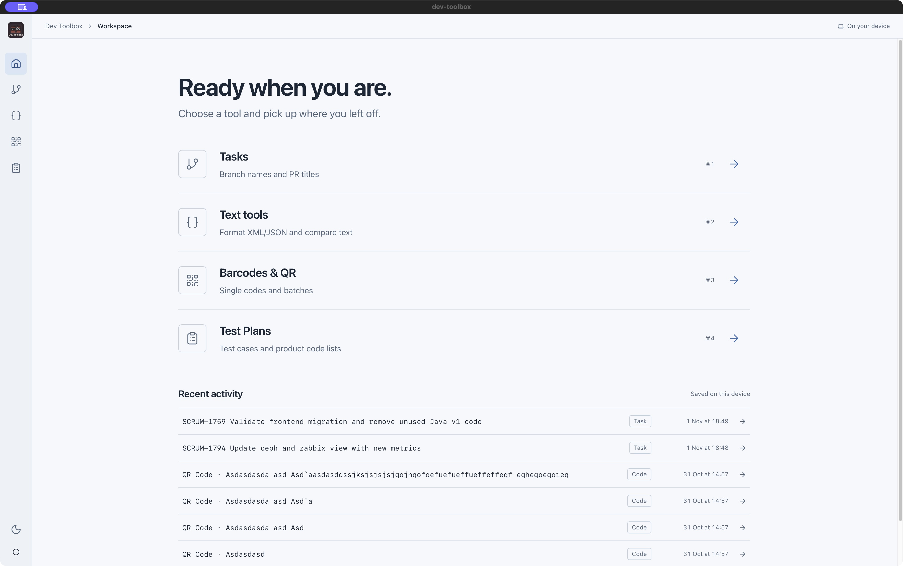

## Turn a task into Git-ready text

Create consistent branch names and pull request titles without composing them by hand.

1. Open **Tasks → New task**. Enter a task number and a short task name.
2. Choose **Feature**, **Bugfix**, or **Hotfix** as the branch type; record the Jira issue type when useful.
3. Watch the branch name and PR title update as you type. Use their **Copy** buttons.
4. Choose **Save task** to keep the task in local history.

**Example:** DEMO-124 + “Improve keyboard navigation” produces `feature/DEMO-124-improve-keyboard-navigation` and `DEMO-124: Improve keyboard navigation`.

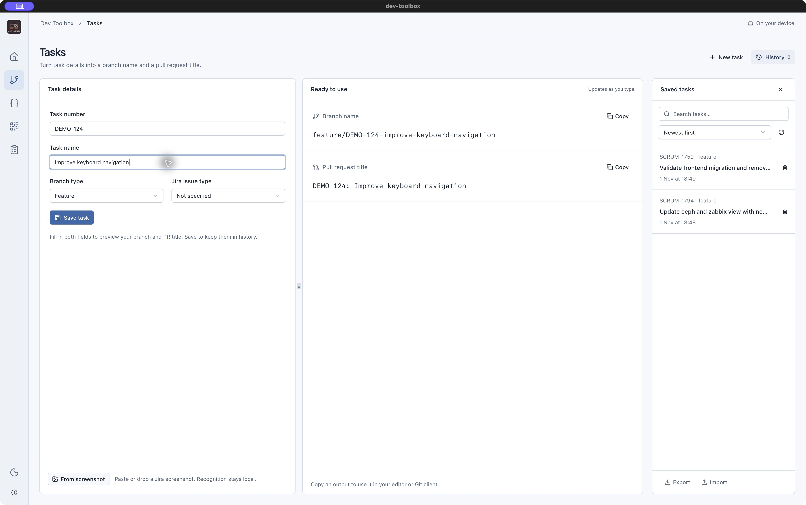

## Capture task details from a screenshot

Local OCR can suggest task metadata from a Jira screenshot, reducing manual entry.

1. In Tasks, choose **From screenshot** to select a PNG or JPEG. You can also paste an image with **⌘/Ctrl+V** or drop a supported image.
2. Review the recognition suggestions and correct the task number, name, and issue type as needed.
3. Check the generated outputs, then save the task when the details are correct.

Recognition stays local. OCR is a starting point: small text, cropped issue keys, and unusual Jira layouts can require corrections. This screenshot highlights the entry point; it does not show a completed OCR run.


## Find and reuse saved tasks

History keeps previous branch names and PR titles available after restarting the app.

1. Open **History**, search saved tasks, and choose newest-first or oldest-first order.
2. Select a task to inspect its saved details and copy its outputs. Saved records open read only.
3. Use **Use as draft** when you want to reuse a record as the basis for another task.
4. Use **Export** for a JSON backup or **Import** to bring tasks from a previous export.

The history panel also offers refresh and per-task deletion. Task exports are separate from code history and Test Plans exports.

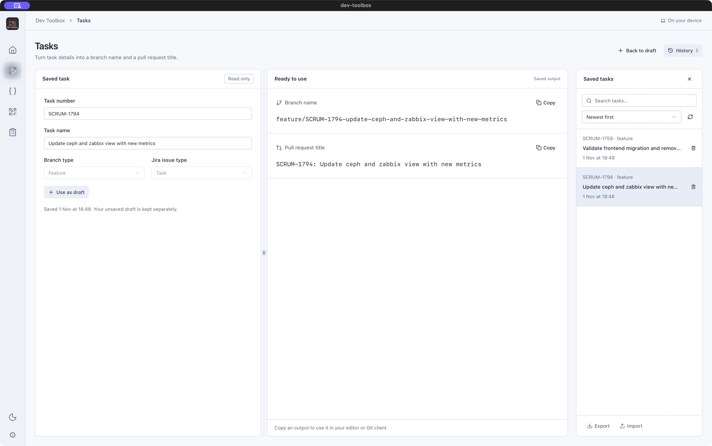

## Format XML, XAML, and JSON

A split editor makes it easy to compare your input with clean, indented output.

1. Open **Text tools → Format** and select **XML / XAML** or **JSON**.
2. Paste your document into the input editor.
3. Choose **Format XML** or the corresponding JSON action, or press **⌘/Ctrl+Shift+F**.
4. Copy the formatted output. Use **⌘/Ctrl+F** to search within an editor, or **Clear** to start over.

XML is checked for syntax before formatting; XAML runtime behavior is not validated. JSON formatting preserves number precision and key order. Invalid JSON keeps the previous successful output. Editor panels are resizable.

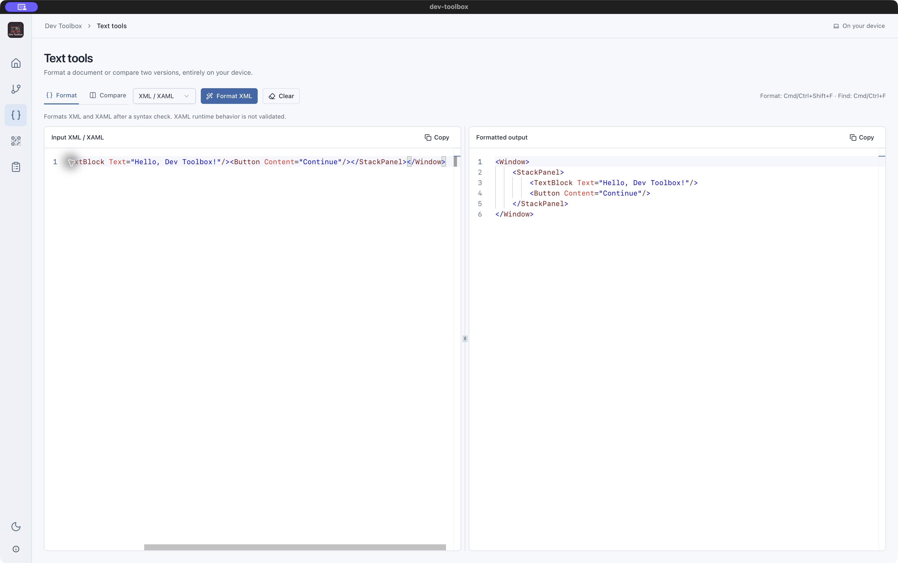

## Compare two versions of text

Spot edits in configuration, code, or plain text with highlighted differences.

1. Open **Text tools → Compare**. Paste text into **Original** and **Modified**.
2. Edit either side and inspect the highlighted changes and changed-region count.
3. Choose **Side by side** or inline layout. Enable **Ignore leading/trailing whitespace** when those differences are irrelevant.
4. Use **Swap sides**, the separate copy buttons, or **Clear** as needed.

Comparison works with text as entered. Formatting and comparison are separate modes, so you can choose whether to normalize a document before comparing it.

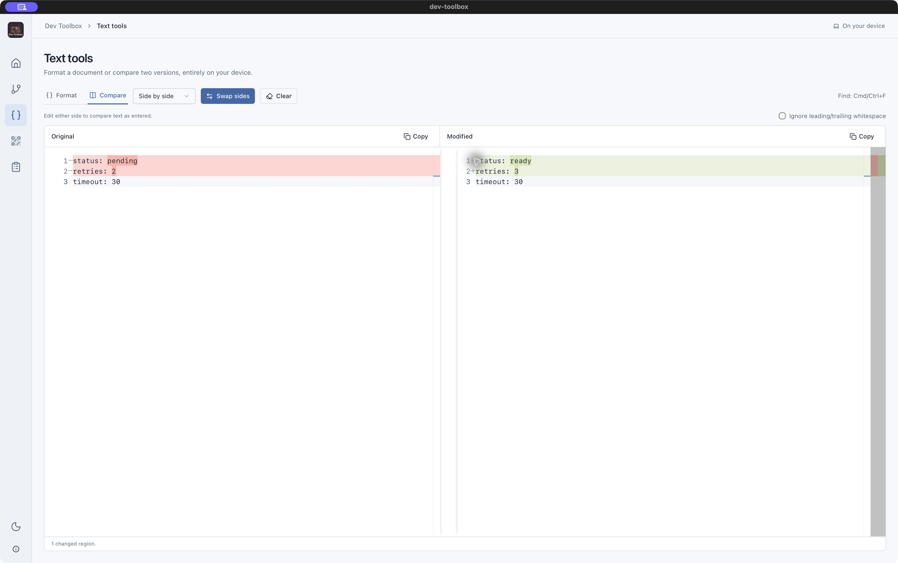

## Generate a barcode or QR code

Create a scannable code, inspect the result, and export it for use elsewhere.

1. Open **Barcodes & QR → Single**.
2. Choose **QR Code**, **EAN-13**, **DataMatrix**, or **Code128**, then enter a value.
3. Choose **Generate code**. Adjust the preview size to inspect the result.
4. Export **SVG** or **PNG**, or use **Copy SVG**. Successful generations are saved in history.

**EAN-13:** enter 12 digits to calculate the check digit, or 13 digits to validate an existing code. The example below turns `590123412345` into `5901234123457`. Use SVG for scalable artwork and PNG when an image file is required.

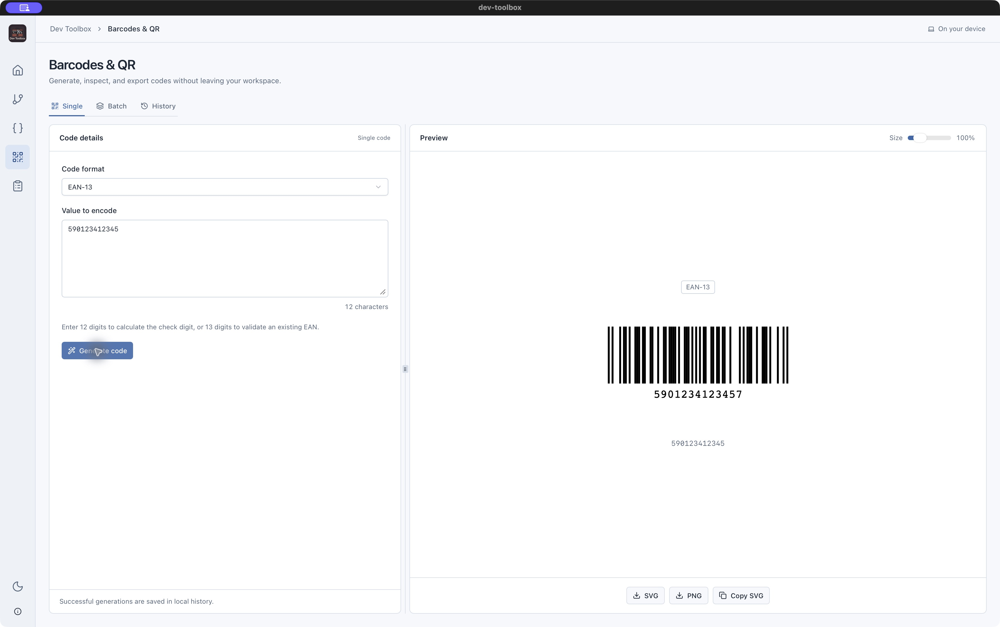

## Generate many codes together

Batch input prepares multiple codes in one operation.

1. Open **Batch** and choose the input format.
2. For **One per line**, choose one shared code format and enter each value on its own line.
3. For **JSON**, enter an array whose items contain `text` and `type` to mix formats.
4. Choose **Generate batch** and inspect the results. Individual errors remain associated with the batch.

**JSON example:**
```json
[{"text":"https://example.com","type":"QR Code"},
 {"text":"590123412345","type":"EAN-13"}]
```
Successful generations are kept in local history.

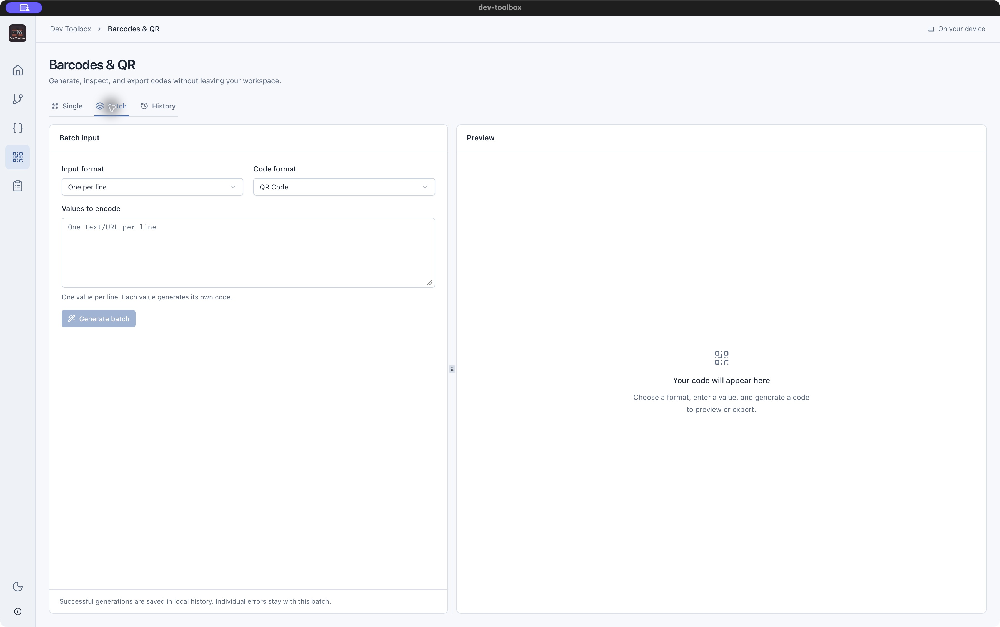

## Reuse code generations

Recover the input and settings behind a previous single code or batch.

1. Open **History** and search the saved entries.
2. Select an entry to inspect its summary, time, and encoded value. Expand **JSON details** for the stored payload.
3. Choose **Use again** to bring its state back into the editor.
4. Use **Export** and **Import** to transfer code history as JSON; refresh or delete entries from the history list.

Code history is separate from Test Plans product lists. Export each area separately when you need a complete backup of your work.

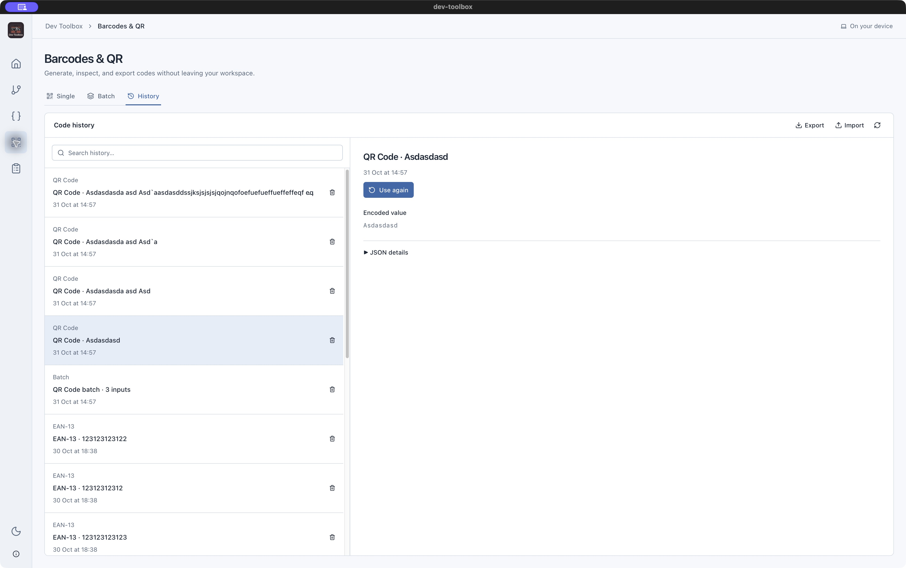

## Write structured test cases

Projects organize saved cases. Each case combines a Markdown description with named product code lists.

1. Open **Test Plans**. Choose **New project**, then **New test case**.
2. Enter a case title and use **Edit Markdown** in Description to write the objective, preconditions, procedure, and expected results.
3. Use formatted previews for headings, tables, task lists, and code blocks.
4. Choose **Save case**. Use the Projects explorer to switch cases, or hide it for more workspace.

Description and Test List belong to the same case. Draft changes are protected when navigating or closing the window. This version prepares test material; it does not track execution results. The illustrated product case uses synthetic test EANs.

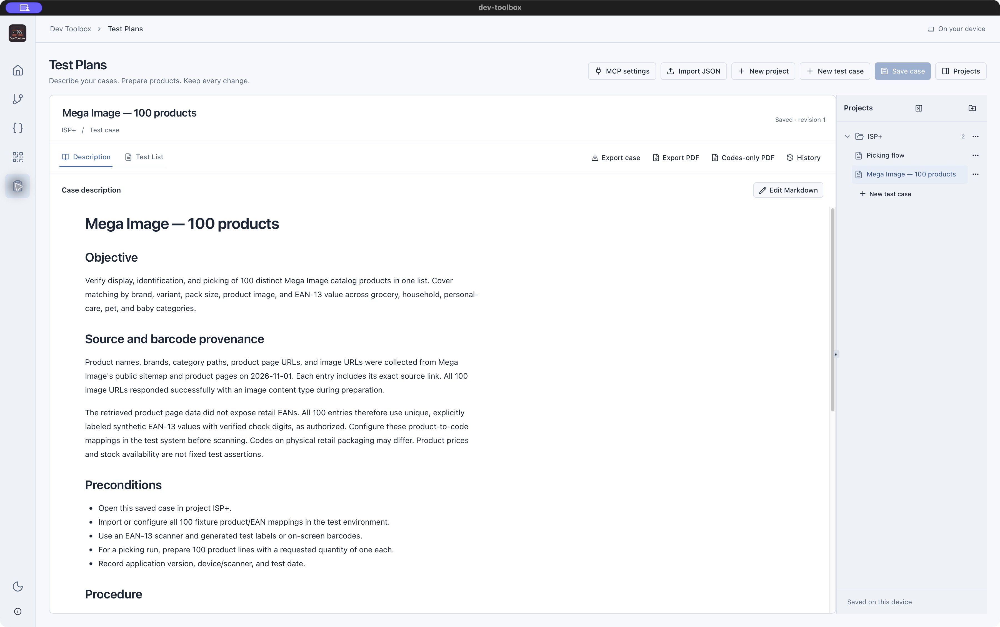

## Build product lists and inspect codes

Keep product metadata, images, and barcode fixtures beside your test instructions.

1. Open a case’s **Test List**. Create or choose a named **Code list**.
2. Use **Product** for individual entries, or **Bulk input** for lines or JSON. JSON accepts `text`, `type`, `title`, `imageUrl`, and `description`.
3. Choose **Generate list**, search products, and select an entry to inspect its code, title, description, and image.
4. Edit or delete products as needed. Use **Full screen** to enlarge a code; Escape closes it. Export SVG/PNG or copy SVG. Save the case to preserve edits.

Use list actions to manage named lists. Product images use their saved URLs and need network access. Supported code formats are QR Code, EAN-13, DataMatrix, and Code128.

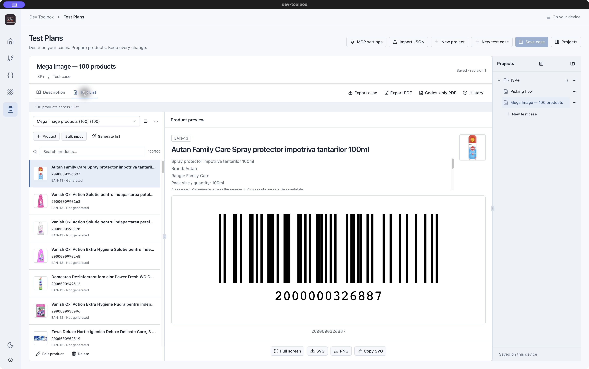

## Inspect previous case revisions

Saved revisions help explain how a case changed over time.

1. Save a case after meaningful edits.
2. Choose **History** to see saved revisions, newest first.
3. Select a revision to read its change summary, description, product lists, and available source changes.
4. Close history to return to the current case.

Historical views let you inspect saved content. Revision history is local and is not included when you share a case or project as JSON.

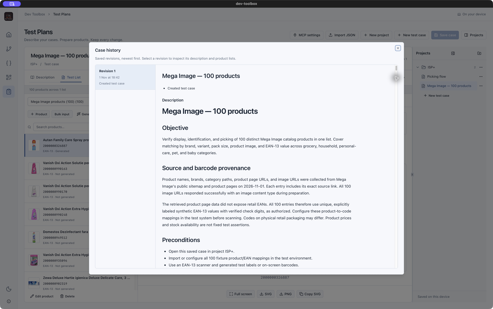

## Share cases and produce printable sheets

Choose JSON for reusable test material, a full PDF for documentation, or a codes-only PDF for scanning.

1. Use **Export case** for the current case, including unsaved edits. Use the project’s explorer menu to export a whole project.
2. Choose **Import JSON**, inspect the preview, and choose a destination for a single case. Imports create new copies.
3. Choose **Export PDF** for the title, rendered Markdown, all lists, metadata, codes, and product images.
4. Choose **Codes-only PDF** for a compact sheet of codes with titles underneath.

PDF exports include every list and entry, including unsaved edits; search filters do not reduce the export. Large exports show progress and cancellation. JSON preserves editable content and image URLs, but excludes revision history and generated/downloaded images. Codes regenerate locally. Imported cases begin at revision 1.


## Connect an AI agent with MCP

The installed app includes a local MCP server for working with saved Test Plans from a compatible agent client.

1. Open **Test Plans → MCP settings**.
2. Choose **Copy MCP configuration**, paste it into your client’s MCP configuration, and reconnect the client.
3. Optionally use **Check connection** to start a temporary server check. Your client starts its own stdio server automatically.
4. After agent edits, reload Test Plans to see saved changes. Reconnect the client after app updates.

No separate Node installation or source checkout is required. Tools cover projects, cases, products, Markdown, revisions, JSON transfers, code generation, and both PDF formats. Connected agents can edit and permanently delete plans and read/write files for imports and exports.

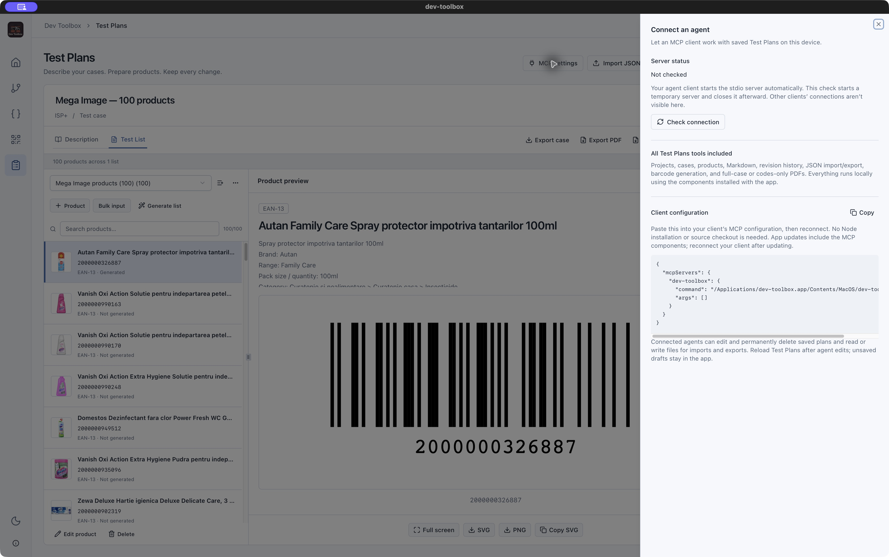

## Appearance and software updates

Use the navigation rail’s theme control and About panel to manage the desktop experience.

1. Use the sun/moon control in the left rail to switch between light and dark appearance.
2. Open **About and updates** to see the installed version.
3. Choose **Check for updates** or **View releases**. When an update is available, review its notes and choose **Update and restart**.

These screenshots were taken from the installed app at version 0.3.2. The guide describes available workflows; imports, deletion, OCR recognition, PDF export, and updating were not executed during this documentation capture.

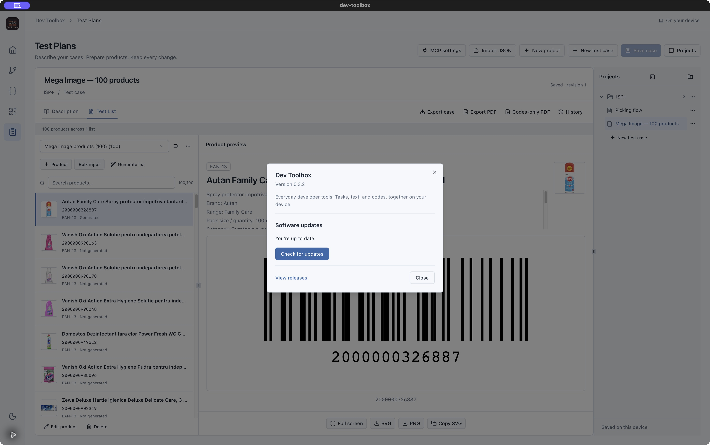

---

[Repository](https://github.com/CristiSandu/dev-toolbox) · [Download the standalone HTML guide](https://github.com/CristiSandu/dev-toolbox/raw/refs/heads/main/docs/walkthrough/index.html)
